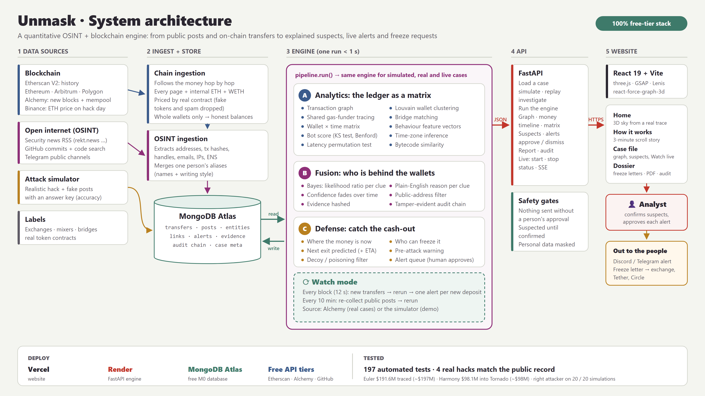

# Unmask: architecture

The diagram is [architecture.png](architecture.png) (3840 × 2160, 16:9, drops straight into a slide) and [architecture.svg](architecture.svg) (vector, for editing or scaling).

## In one paragraph
Unmask pulls in two kinds of evidence: **on-chain transfers** (Etherscan history, Alchemy live blocks) and **public posts** (security news, GitHub, Telegram). It stores them in MongoDB in one clean format and runs a single engine over them in under a second. The engine:
- clusters the attacker's wallets;
- scores which online identity is behind them, with a reason for every clue;
- works out where the money is, what can be frozen and where it will be cashed out next.

A FastAPI service exposes the results to a React website. **Watch mode** reruns the engine every block while a case is live. Nothing leaves the system until an analyst approves it.

---

## 1. Data sources

| Source | What it gives | Used by |
|---|---|---|
| **Etherscan API V2** | A wallet's full history: normal, internal and token transfers on Ethereum, Arbitrum and Polygon (the free chains) | Real hacks, "Trace any address" |
| **Alchemy** | New blocks for watched wallets, and pending (mempool) transactions | Watch mode, mempool check |
| **Binance public prices** | ETH's closing price on the hack date | Dollar values on old hacks |
| **RSS** (rekt.news, SlowMist, Chainalysis, Cointelegraph, Web3 Is Going Great) | Security news posts | OSINT |
| **GitHub REST** | Commit search and code search (with a token) | OSINT: code, handles, addresses |
| **Telegram** (optional) | Public channel messages | OSINT |
| **Attack simulator** | A realistic hack with fake posts and an **answer key** | Demo and accuracy measurement |
| **Labels** (`data/labels/*.csv`) | Exchanges, mixers, bridges, plus the real contracts of priced tokens | Everywhere |

## 2. Ingest and store (`backend/gt/chain`, `backend/gt/osint`, `backend/gt/db.py`)

**Chain ingestion** (`chain/etherscan.py`, `chain/live.py`, `chain/normalize.py`):
- **Breadth-first money trace** from the seed addresses, following only transfers that carry value. Exchanges, mixers, bridges and the victim are never expanded.
- **Every page** of a wallet's history, up to Etherscan's 10,000-row ceiling.
- **Internal ETH transfers**, plus the **WETH** side of wraps and unwraps, which emit no token event.
- Tokens are **priced by their real contract address**: look-alike "DAI" from address-poisoning spam becomes `fake:DAI` and is never counted.
- A wallet is loaded **whole or not at all**, so only fully loaded wallets count as "held".
- Errors are retried with backoff and **never cached as "no data"**; good answers are cached on disk.

**OSINT ingestion** (`osint/collectors.py`, `osint/extract.py`, `osint/style.py`):
- Extracts addresses, transaction hashes, handles, emails, IPs and ENS names from each post.
- Merges one person's aliases by name similarity and writing style.

**Normalization at the boundary:** lowercase addresses, integer UTC timestamps, token units (not wei). Every module downstream relies on this.

**MongoDB** (`db.py`): one collection per data class in `schema.py`.

| Collection | Holds |
|---|---|
| `transfer` | Every move: hash, chain, time, from, to, asset, amount, role (transfer, mixer_in, bridge_out, swap, deploy…) |
| `osintpost` / `entity` | Posts, and the identity markers pulled out of them |
| `link` | A suspected wallet-cluster → identity link: score, clues, status (suspected / confirmed / rejected) |
| `alert` | Proposed actions: status pending → approved → sent, or dismissed |
| `evidence` | Hashed copies of every clue behind a link |
| `auditentry` | Hash-chained record of every human decision (tamper-evident) |
| `meta` | The loaded case (labels, seeds, ETH price, fully loaded wallets) and the last results |

With `MONGODB_URI` unset or set to `mongomock://`, everything runs in memory. That's what the tests and the offline demo use.

## 3. The engine (`backend/gt/pipeline.py` → `run()`)

The same function runs for simulated, real and live cases.

**A. Analytics: the ledger as a matrix** (`analytics/`)

| Step | Method |
|---|---|
| Transaction graph | NetworkX multigraph of value moves |
| Wallet clustering | Louvain communities + **shared gas funders** (who paid a fresh wallet's fees) + seeds; third-party contracts are split off |
| Bridge matching | The same amount out on one chain and in on another, minutes apart |
| Wallet × time matrix, feature vectors | Activity per time slot; volume, timing and gas habits per wallet |
| Bot score | KS test of timing against random arrivals, round-amount check, Benford's law on first digits |
| Time-zone inference | Matches the hour-of-day histogram to a human waking window |
| **Latency test** | Do a person's posts come just before the wallets move? A permutation test (post times shifted 500×) gives a p-value |
| Bytecode similarity | Function selectors in posted code vs. the deployed contract |

**B. Fusion: who is behind the wallets** (`fusion/score.py`, `fusion/evidence.py`)
- Each clue becomes a **likelihood ratio**, and Bayes' rule combines them (prior 1%) into one probability with a plain-English reason per clue.
- Confidence **fades** with a one-week half-life when there's no fresh activity.
- **Public-address filter:** quoting a seed address, or one that several people posted, is public knowledge rather than evidence. This keeps researchers from being flagged.
- Each clue is hashed into the evidence store. Links stay **"suspected"** until a person confirms them.

**C. Defense: catch the cash-out** (`defense/`)
- **Where the money is:** held (fully loaded wallets only), in a mixer, at an exchange, or given back to the victim.
- **Freezability:** exchange deposits (the exchange), USDT (Tether), USDC (Circle).
- **Exit prediction:** the next exchange and an ETA, but only when cash-outs already seen cover at least 5% of the money.
- **Pre-attack warning:** a mixer-funded wallet that deploys a contract and test-calls it. **Decoy filter:** wallets the attacker only sprayed with dust, and look-alikes of known addresses, are kept out of the cluster.
- **Alert queue:** proposals only. A person approves each one before anything is sent.
- **Freeze tracking:** each freeze letter carries how-to-send guidance and a status (sent → replied → frozen / declined) recorded in the audit chain; confirmed money moves to a Frozen total.

**Watch mode** (`watch.py`):
- **Every block (12 s):** new transfers for up to 10 attacker wallets (Alchemy, or the simulator on a demo case) → stored with their role → one alert per new exchange or mixer deposit → the engine reruns.
- **Every 10 minutes:** posts are re-collected in the background, then the engine reruns.
- It stops after 30 minutes, when another case is loaded, or on request.

## 4. API (`backend/gt/api.py`, FastAPI)

| Group | Endpoints |
|---|---|
| Load a case | `POST /simulate`, `GET /replays`, `POST /replay/{name}`, `POST /investigate` |
| Run | `POST /run` |
| Views | `GET /graph`, `/money-now`, `/timeline`, `/heatmap/{key}`, `/sankey`, `/matrix`, `/wallet/{addr}`, `/mempool` |
| Decisions | `GET /links`, `POST /links/{id}/confirm or reject`, `GET /alerts`, `POST /alerts/{id}/approve or dismiss` |
| Dossier | `GET /report`, `POST /report/export`, `POST /privacy/reveal`, `POST /freeze/{party}/{status}` |
| OSINT | `POST /osint/collect` |
| Live | `POST /live/start`, `POST /live/stop`, `GET /live/status`, `GET /live` (server-sent events) |

Every decision endpoint writes to the audit chain under the analyst's name (the `X-Analyst` header).

## 5. Website (`frontend/`, React 19 + Vite)

| Page | Built with |
|---|---|
| **Home** `/` | three.js night sky drawn from a snapshot of the real Euler trace; GSAP ScrollTrigger + Lenis for scrolling |
| **How it works** `/how-it-works` | Scroll-driven 3D story of the $42M attack from the problem statement |
| **Case file** `/case` | 3D money graph (react-force-graph-3d), money panel, suspects, alert queue, timeline, clock, route chart, matrix, Watch live |
| **Dossier** `/report` | Printable report: freeze letters, evidence, masked personal data, audit check |

The site reads the API address from `VITE_API_URL`.

## 6. One case, end to end
1. **Load:** a simulation, a stored real hack, or any address. The chain trace (or the simulator) writes transfers into MongoDB.
2. **Run:** cluster → extract → fuse → defend. Results are saved, and new alerts land in the queue as "pending".
3. **Look:** the website reads the results through the API.
4. **Watch (optional):** every block, new moves → rerun → new alerts, with no clicks.
5. **Decide:** the analyst confirms or rejects suspects and approves alerts. Approved alerts go to Discord or Telegram, and every decision is hash-chained.
6. **Report:** the dossier carries the freeze letters and the audit head that pins the record.

## 7. Deployment (all free tiers)

| Part | Where | Settings |
|---|---|---|
| Website | Vercel (root `frontend`, Vite preset) | `VITE_API_URL` |
| Engine | Render free web service (root `backend`, `uvicorn gt.api:app --host 0.0.0.0 --port $PORT`) | Keys in Render's environment; `FRONTEND_ORIGINS` for CORS |
| Database | MongoDB Atlas M0 | `MONGODB_URI` |
| APIs | Etherscan, Alchemy, GitHub, Groq/Gemini, Discord/Telegram | Free keys in `backend/.env` (never committed) |

## 8. Design decisions
- **One engine, three data modes.** Simulated, real and live cases go through the same `run()`, so the simulator's accuracy numbers say something about the real thing.
- **The simulator has an answer key.** Real hacks don't publish who did it, so accuracy is measured on simulations (right attacker on 20 of 20) and the money totals on real hacks are checked against public reports.
- **Explainable over black-box.** Every score is a product of named clues with reasons, so an analyst can challenge each one.
- **Humans stay in charge.** Links are "suspected" until confirmed, nothing is sent without approval, personal data is masked, and every decision is audited.
- **Honest numbers.** Holdings count only fully loaded wallets, tokens are priced by their real contract, and money is valued at the hack-date price.
- **Free to run.** Every service is on a free tier, with caching and backoff to stay inside the limits.

## 9. Limits
- One case is loaded at a time, shared by everyone using the server; there's no login yet.
- Watch mode lives inside the server process: it stops if the server sleeps (Render's free tier sleeps after 15 idle minutes) or after 30 minutes.
- Tokens without a known price (WBTC, LP tokens…) aren't counted.
- Very busy wallets (DEX pools) can't be loaded whole, so money that reaches them is only "last seen".

Module-by-module detail: [modules/README.md](modules/README.md). The guide for judges and demos: [judges-guide.md](judges-guide.md).
